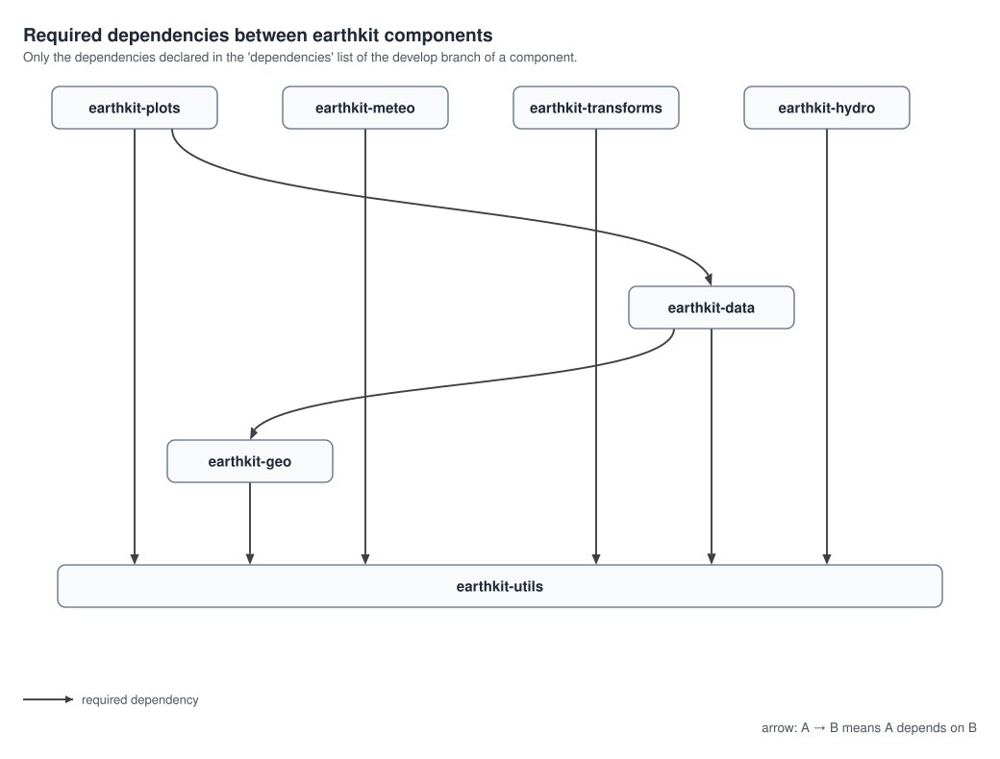
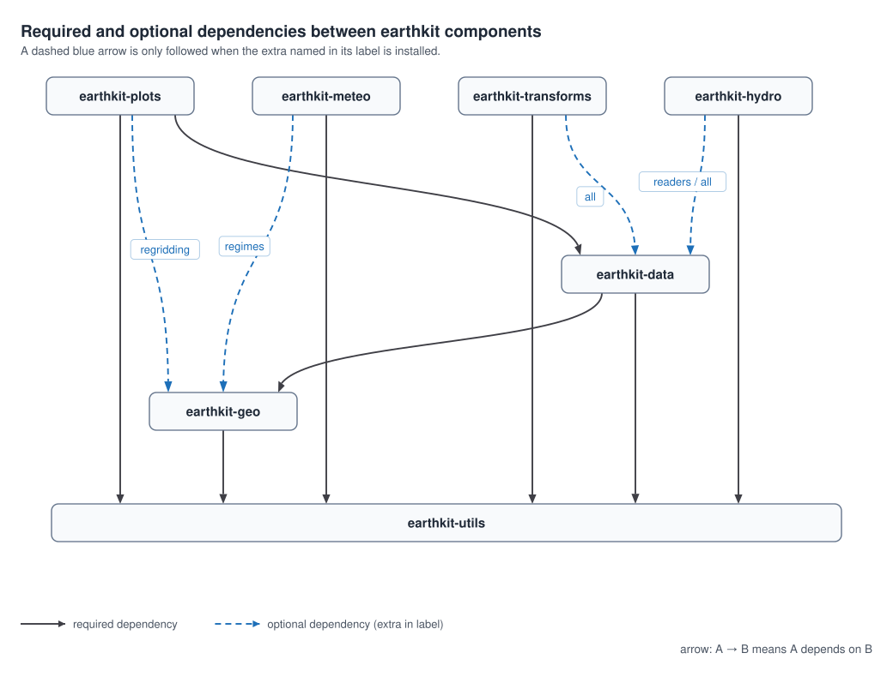
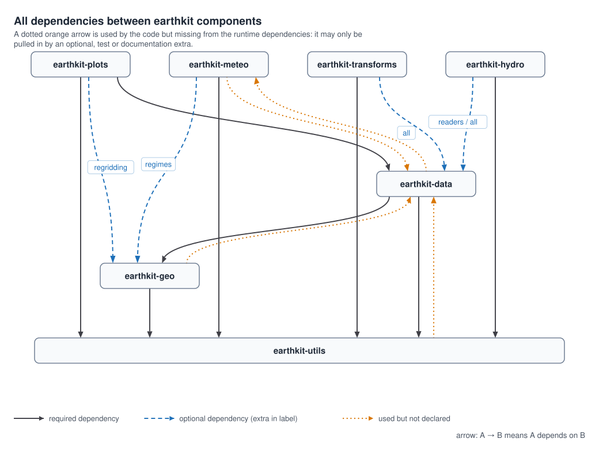
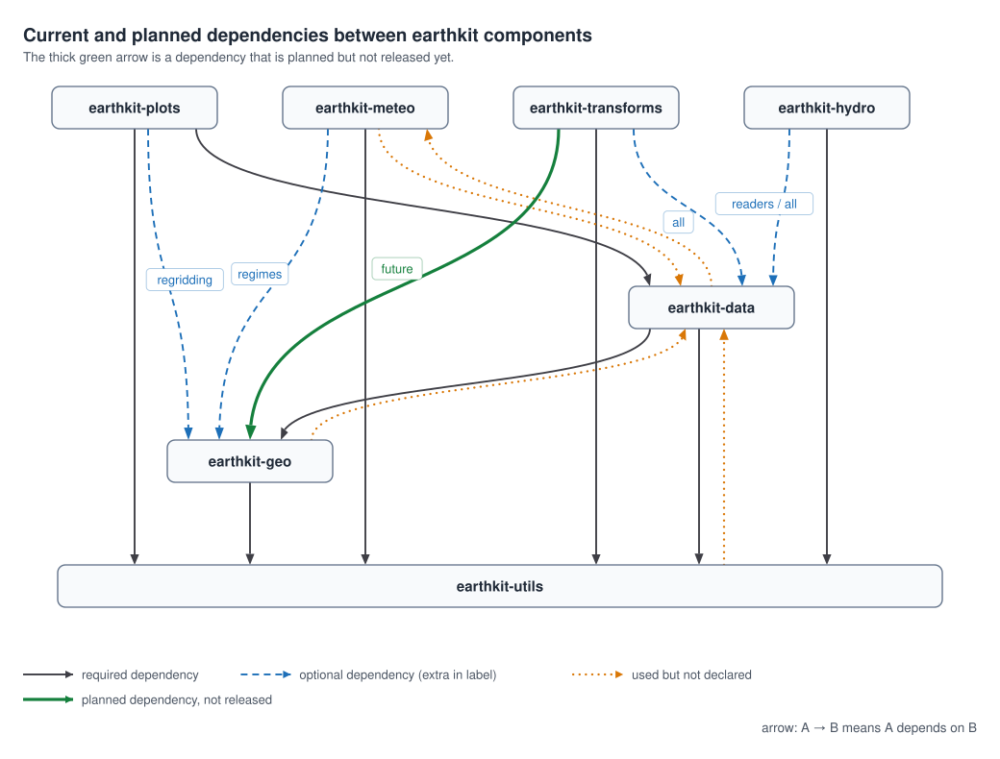

.. _component-dependencies:

Dependencies between earthkit components
========================================

The earthkit components are separate Python packages designed to work together. This page shows how they
depend on each other, based on the ``develop`` branches of the components (November 2026).

In the graphs, an arrow ``A → B`` means "A depends on B".

The three kinds of dependency
-----------------------------

**Hard dependency.** Listed under ``dependencies`` in ``pyproject.toml``. It is always installed with the
component. For example, installing earthkit-plots also installs earthkit-data.

**Optional dependency.** Listed under ``optional-dependencies`` in a named group, called an *extra*. It is only
installed when you ask for it, e.g. ``pip install "earthkit-meteo[regimes]"`` adds earthkit-geo.

**Used but not declared.** The code uses another component, but ``pyproject.toml`` does not require it (or only
for tests, CI or documentation). pip does not install it. Depending on the code, the feature is skipped when the
component is missing, or an ``ImportError`` is raised.

Dependencies needed only for tests, CI or documentation are not shown.

Summary
-------

.. list-table::
    :header-rows: 1
    :widths: 16 26 30 28

    * - Component
      - Hard
      - Optional (extra)
      - Used, not declared
    * - :xref:`earthkit-data`
      - ``earthkit-geo``, ``earthkit-utils``
      - --
      - ``earthkit-meteo``
    * - :xref:`earthkit-geo`
      - ``earthkit-utils``
      - --
      - ``earthkit-data``
    * - :xref:`earthkit-hydro`
      - ``earthkit-utils``
      - ``earthkit-data`` (``readers``, ``all``)
      - --
    * - :xref:`earthkit-meteo`
      - ``earthkit-utils``
      - ``earthkit-geo`` (``regimes``)
      - ``earthkit-data``
    * - :xref:`earthkit-plots`
      - ``earthkit-utils``, ``earthkit-data``
      - ``earthkit-geo`` (``regridding``)
      - --
    * - :xref:`earthkit-transforms`
      - ``earthkit-utils``
      - ``earthkit-data`` (``all``)
      - --
    * - `earthkit-utils <https://earthkit-utils.readthedocs.io>`_
      - --
      - --
      - ``earthkit-data``

Graphs
------

Solid dark grey arrows are hard dependencies, dashed blue arrows are optional dependencies (labelled with the
extra), and dotted orange arrows are used but not declared.

Notable points
--------------

* **earthkit-utils** is the base of everything: it depends on no other component, and all the others depend on it.
* **earthkit-meteo** imports earthkit-data directly in its fieldlist modules, but declares it only for tests.
  Install earthkit-data yourself to use them.
* **earthkit-geo** and **earthkit-utils** use earthkit-data only when it is installed.
* **earthkit-data** can use earthkit-meteo when it is installed, and otherwise falls back to its own code.
* The ``regridding`` extra of earthkit-plots adds nothing in practice, because earthkit-geo already comes with
  earthkit-data.
* There is no cycle among the hard dependencies.

Planned change: earthkit-geo in earthkit-transforms
---------------------------------------------------

Today earthkit-transforms does not depend on earthkit-geo. It is planned (not released) to make earthkit-geo a
hard dependency of earthkit-transforms. This is the thick green arrow below. Nothing else changes, because
earthkit-geo only depends on earthkit-utils.

